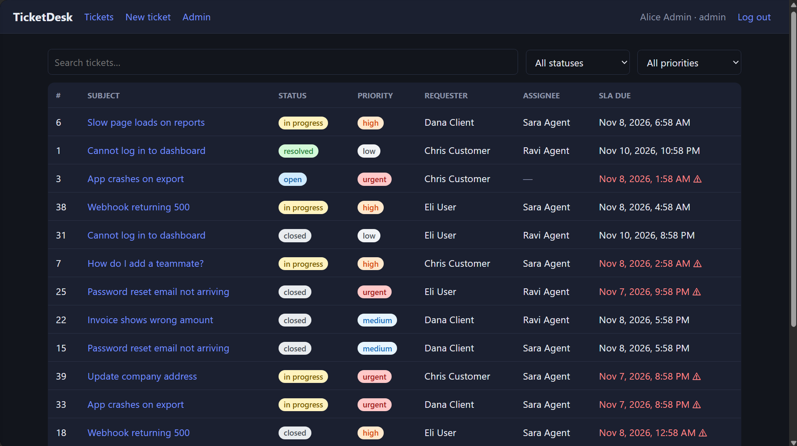
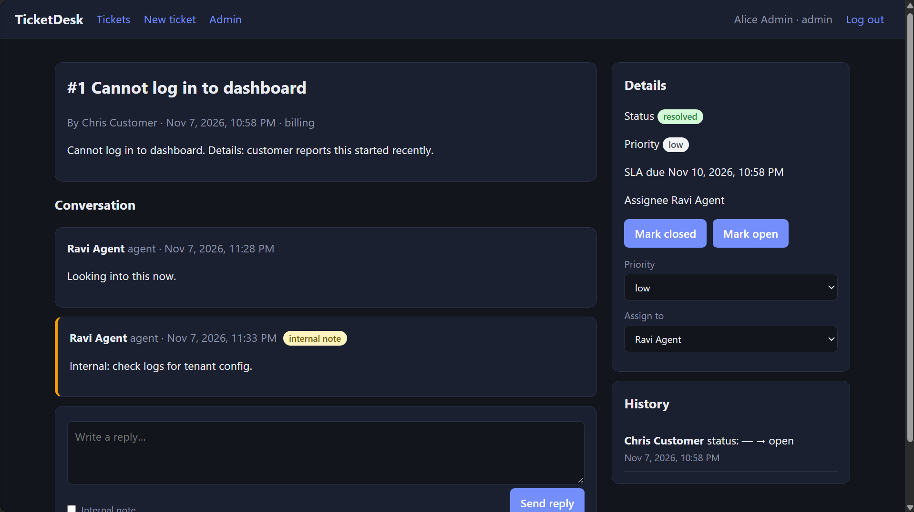
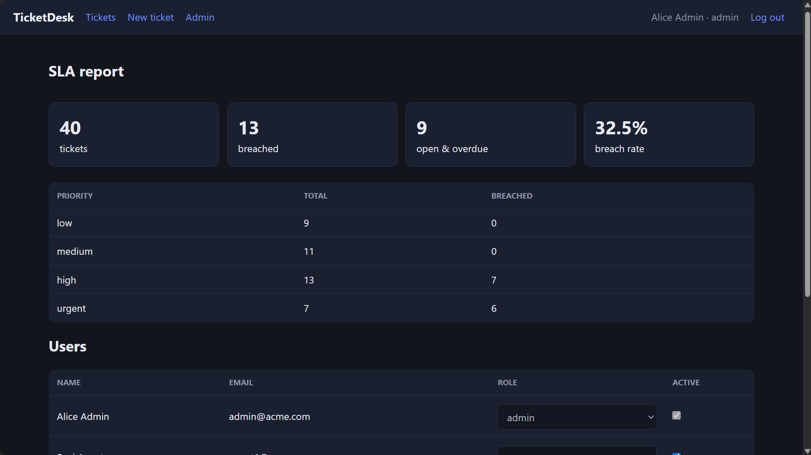
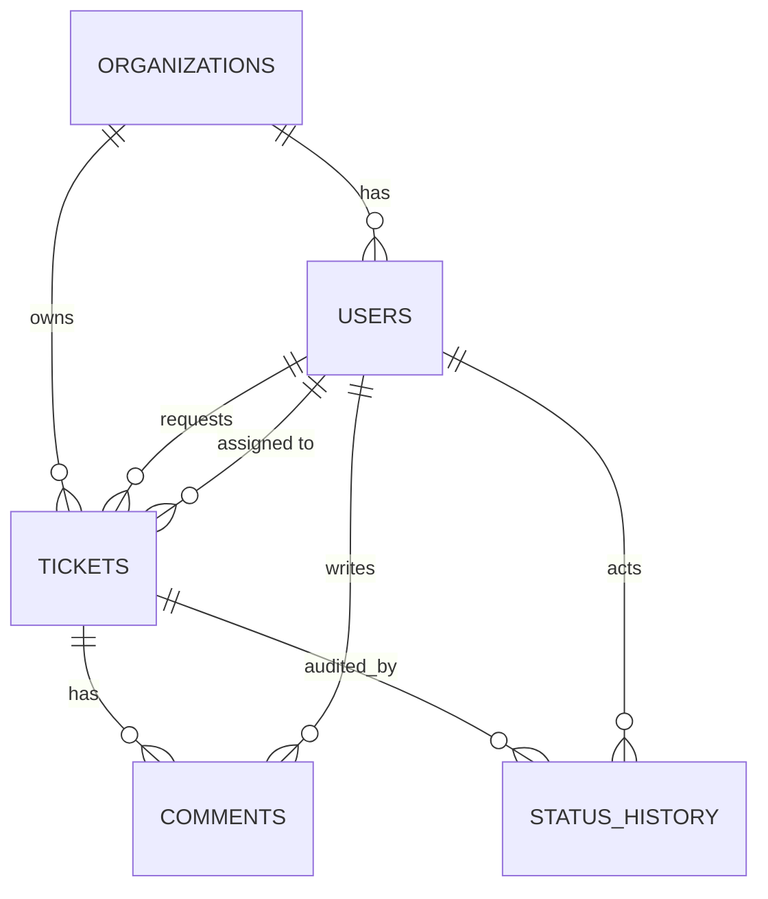

# TicketDesk — Multi-Tenant Support Ticketing System


A customer portal + agent dashboard where companies (tenants) manage support tickets, SLAs and agent workload.
Built with **FastAPI, PostgreSQL, SQLAlchemy/Alembic, React + TypeScript, Docker**.

**Live demo:** https://ticketdesk-blond.vercel.app · **Demo login:** workspace `acme`, `admin@acme.com` / `demo1234`

## Screenshots







## Features
- **Three roles** — customer (own tickets only), agent (all tickets in their org), admin (users + SLA report)
- **Ticket lifecycle** — Open → In Progress → Resolved → Closed (+ reopen), validated server-side
- **Internal notes** vs customer-visible replies (internal notes are never returned to customers)
- **Audit trail** — every status / priority / assignee change recorded with actor and timestamp
- **SLA tracking** — deadline per priority (urgent 4h … low 72h), background worker flags breaches, admin report
- **Search, filter, pagination** — Postgres full-text search (GIN index), status/priority/assignee/date/SLA filters
- **Email notifications** on status change and staff replies (SMTP, or logged in dev)
- **Multi-tenancy** — every query is scoped by `org_id`; cross-tenant access returns 404

## Architecture
```
React (Vite, React Query)  ──HTTP/JSON + JWT──▶  FastAPI  ──SQLAlchemy──▶  PostgreSQL
                                                    ▲
                                  SLA worker (python -m app.worker) ─────────┘
```

## ER diagram


## Run it (one command)
```bash
docker compose up --build   # starts Postgres, API, SLA worker and web; seeds demo data
```
Web: http://localhost:5173 · API docs: http://localhost:8000/docs

See **DEPLOY.md** for putting it online for free (Neon + Render + Vercel).

### Without Docker
```bash
cd backend && pip install -r requirements-dev.txt
export DATABASE_URL=sqlite:///dev.db && alembic upgrade head && python -m app.seed
uvicorn app.main:app --reload
cd ../frontend && npm install && npm run dev
```

## Tests
```bash
cd backend && pytest -q      # auth, RBAC, tenant isolation, workflow, SLA, search
cd frontend && npm run build # type-check + production build
```

## Engineering decisions & trade-offs
| Decision | Why | Trade-off / next step |
|---|---|---|
| Authorization in a single `get_ticket_or_404` helper + `require_roles` deps | One choke point for tenant + ownership checks; unauthorized access looks like 404 (no ID probing) | Fine-grained per-queue permissions would need a policy layer |
| Access + refresh JWTs (15 min / 7 days), `type` claim checked | Short-lived access tokens; refresh can't be used as access | No server-side revocation; add a token table/Redis denylist for logout-everywhere |
| Same error for unknown user and wrong password; bcrypt; login rate limit | Prevents account enumeration and brute force | Limiter is in-memory; use Redis with multiple API replicas |
| Status transitions as an explicit table | Invalid jumps (open → resolved) rejected with 409 | Workflow is hard-coded, not configurable per tenant |
| SLA worker as a separate loop (not Celery) | Idempotent single query; zero extra infrastructure | Move to Celery/RQ once there are many jobs (retries, per-email queueing) |
| Email via FastAPI `BackgroundTasks` | Keeps requests fast | Not durable across crashes; use a queue for guaranteed delivery |
| `joinedload` on list/detail queries | Avoids N+1 queries | — |
| Tests run on SQLite; FTS falls back to `ILIKE` | Fast, dependency-free CI | Postgres-specific paths (tsvector) aren't covered in CI; add a Postgres service job |

## Roadmap
File attachments (S3/MinIO), Redis cache + rate limiting, Postgres job in CI, per-tenant SLA policies, WebSocket live updates.
